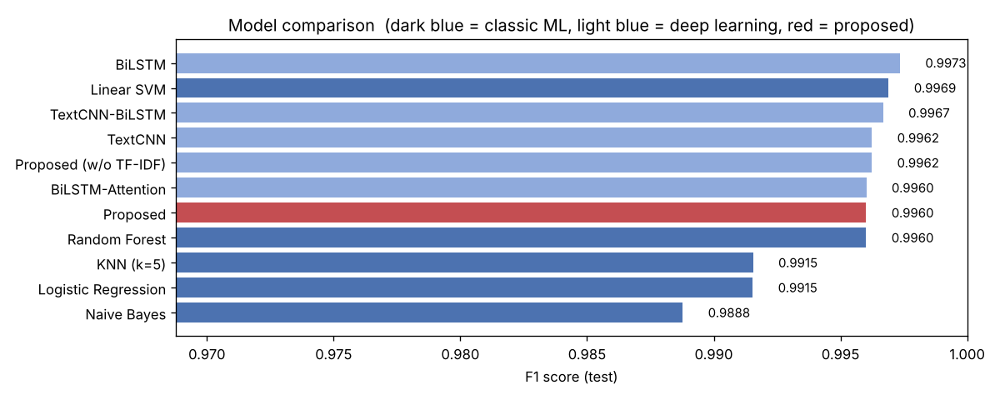
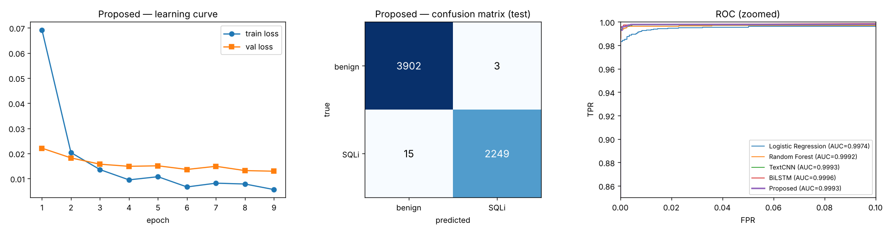

<div dir="rtl">

# DeetectionPedar — تشخیص SQL Injection با یادگیری عمیق

پیاده‌سازی مدل ترکیبی **TF-IDF/Word2Vec → TextCNN بهبودیافته → Bi-LSTM → Attention** برای تشخیص حملات SQL Injection، بر اساس مقاله‌ی:

> H. Sun, Y. Du, Q. Li, **"Deep Learning-Based Detection Technology for SQL Injection Research and Implementation"**,
> *Applied Sciences* (MDPI), vol. 13, no. 16, Art. 9466, 2023. DOI: [10.3390/app13169466](https://doi.org/10.3390/app13169466) — JCR Q2

همه چیز داخل یک نوت‌بوک Jupyter است:
[`notebooks/SQLi_Detection_TextCNN_BiLSTM_Attention.ipynb`](notebooks/SQLi_Detection_TextCNN_BiLSTM_Attention.ipynb)
(نسخه‌ی اجراشده، همراه با خروجی‌ها و نمودارها)

## معماری

</div>

```
SQL query ─► SQL-aware tokenizer (lowercase, numbers→<num>, hex→<hex>, operators as tokens)
          ─► Embedding (Word2Vec skip-gram init, fine-tuned)  ×  per-token TF-IDF weight      ← fusion
          ─► Improved TextCNN: Conv1d k∈{2,3,4,5}, 64 filters each, padding='same' (sequence kept)
          ─► Bi-LSTM (128 per direction)
          ─► Additive attention (masked)
          ─► Dense(64) + Dropout(0.5) ─► sigmoid  →  P(SQLi)
```

<div dir="rtl">

## دیتاست

[SQL Injection Dataset — Kaggle (sajid576)](https://www.kaggle.com/datasets/sajid576/sql-injection-dataset)، فایل `Modified_SQL_Dataset.csv`:
۳۰٬۹۱۹ کوئری (۱۹٬۵۳۷ سالم، ۱۱٬۳۸۲ SQLi). بعد از حذف کوئری‌های تکراری، خالی و با برچسب متناقض ۳۰٬۸۴۳ کوئری باقی می‌ماند
که به نسبت ۷۰/۱۰/۲۰ (train/val/test، stratified) تقسیم می‌شود. نوت‌بوک دیتاست را خودکار دانلود می‌کند (جزئیات در [`data/README.md`](data/README.md)).

## نتایج (داده‌ی test، ۶٬۱۶۹ کوئری)

</div>

| Model | Type | Accuracy | Precision | Recall | F1 | FPR | AUC |
|---|---|---|---|---|---|---|---|
| **Proposed (mean ± std, 3 seeds)** | DL | 0.9977 | 0.9993 | 0.9946 | **0.9969 ± 0.0008** | 0.0004 | 0.9993 |
| BiLSTM | DL | 0.9981 | 0.9987 | 0.9960 | 0.9973 | 0.0008 | 0.9996 |
| TextCNN-BiLSTM (no attention) | DL | 0.9976 | 0.9991 | 0.9943 | 0.9967 | 0.0005 | 0.9994 |
| TextCNN | DL | 0.9972 | 0.9982 | 0.9943 | 0.9962 | 0.0010 | 0.9993 |
| Proposed w/o TF-IDF | DL | 0.9972 | 0.9991 | 0.9934 | 0.9962 | 0.0005 | 0.9995 |
| BiLSTM-Attention | DL | 0.9971 | 0.9978 | 0.9943 | 0.9960 | 0.0013 | 0.9994 |
| Linear SVM (TF-IDF) | ML | 0.9977 | 0.9991 | 0.9947 | 0.9969 | 0.0005 | 0.9980 |
| Random Forest (TF-IDF) | ML | 0.9971 | 0.9991 | 0.9929 | 0.9960 | 0.0005 | 0.9992 |
| KNN (TF-IDF) | ML | 0.9938 | 0.9987 | 0.9845 | 0.9915 | 0.0008 | 0.9965 |
| Logistic Regression (TF-IDF) | ML | 0.9938 | 1.0000 | 0.9832 | 0.9915 | 0.0000 | 0.9974 |
| Naive Bayes (TF-IDF) | ML | 0.9917 | 0.9855 | 0.9921 | 0.9888 | 0.0085 | 0.9981 |

<div dir="rtl">

جدول کامل در [`results/test_metrics.csv`](results/test_metrics.csv) و [`results/proposed_seeds.csv`](results/proposed_seeds.csv) است.

**تفسیر:** مدل پیشنهادی به F1 ≈ ۹۹.۷٪ می‌رسد، اما روی این دیتاست همه‌ی مدل‌های قوی به سقف رسیده‌اند. اختلاف ۰.۰۰۱ در F1 فقط حدود ۲ تا ۳ نمونه است
و از واریانس بین seed ها کمتر است. پس برتری معناداری نسبت به BiLSTM یا Linear SVM اثبات نمی‌شود.
تحلیل کامل، خطاها، نمودار attention و پیشنهاد سناریوهای ارزیابی سخت‌تر در بخش ۸ و ۱۰ نوت‌بوک آمده است.

<p align="center">
<br>

</p>

## اجرا

</div>

```bash
pip install -r requirements.txt
jupyter notebook notebooks/SQLi_Detection_TextCNN_BiLSTM_Attention.ipynb
```

<div dir="rtl">

- روی CPU (۴ هسته) اجرای کامل حدود ۷۰ دقیقه طول کشید (۸ بار آموزش مدل عمیق). با GPU خیلی سریع‌تر است و کد خودش `cuda` را تشخیص می‌دهد.
- هایپرپارامترها همه در دیکشنری `CFG` در سلول اول هستند.
- برای سریع‌تر شدن می‌توانید `seeds_for_proposed=(42,)` یا `max_epochs` کمتر بگذارید.
- مدل آموزش‌دیده در `models/sqli_textcnn_bilstm_att.pt` ذخیره شده و تابع `load_detector()` در بخش ۹ نوت‌بوک بدون آموزش مجدد از آن استفاده می‌کند.
- نوت‌بوک از روی [`tools/build_notebook.py`](tools/build_notebook.py) ساخته می‌شود. اگر کد را آنجا تغییر دادید، دوباره build و اجرا کنید.

## نکته‌ها و محدودیت‌ها

- مقاله‌ی اصلی روی دیتاست **خصوصی** (تولیدشده با ابزار خود نویسندگان) ارزیابی شده و F1 = 95.64% گزارش کرده است. اینجا همان روش روی دیتاست **عمومی** Kaggle اجرا شده، پس عددها مستقیماً قابل مقایسه نیستند.
- بعضی جزئیات پیاده‌سازی در بخش‌های در دسترس مقاله ذکر نشده بود: اندازه‌ی کرنل‌ها، تعداد فیلترها، ابعاد LSTM و attention، و نحوه‌ی دقیق fusion. مقادیر انتخاب‌شده در نوت‌بوک مستند شده‌اند.
  «TextCNN بهبودیافته» این‌طور تفسیر شده: max-pooling سراسری حذف می‌شود تا خروجی دنباله‌ای بماند و بشود آن را به Bi-LSTM داد.
- چکیده‌ی مقاله به استفاده از بردارهای از پیش آموزش‌دیده‌ی BERT هم اشاره دارد، ولی بخش روش‌شناسی آن TF-IDF + Word2Vec را توصیف می‌کند. اینجا نسخه‌ی TF-IDF + Word2Vec پیاده‌سازی شده است.

## منابع

1. **[مقاله‌ی پیاده‌سازی‌شده]** H. Sun, Y. Du, Q. Li, "Deep Learning-Based Detection Technology for SQL Injection Research and Implementation," *Applied Sciences*, 13(16):9466, 2023. https://doi.org/10.3390/app13169466
2. Y. Kim, "Convolutional Neural Networks for Sentence Classification," *EMNLP*, 2014 — TextCNN.
3. D. Bahdanau, K. Cho, Y. Bengio, "Neural Machine Translation by Jointly Learning to Align and Translate," *ICLR*, 2015 — additive attention.
4. T. Mikolov et al., "Distributed Representations of Words and Phrases and their Compositionality," *NeurIPS*, 2013 — Word2Vec.
5. دیتاست: SQL Injection Dataset (sajid576), Kaggle — https://www.kaggle.com/datasets/sajid576/sql-injection-dataset

</div>
